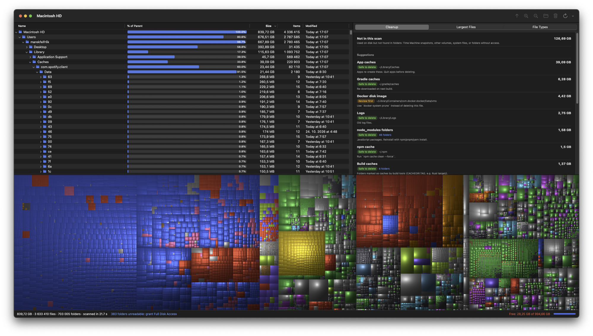

+++
title = "DirectStat: see what fills your Mac's disk"
date = 2026-11-14T16:09:00+01:00
description = "A free, open-source disk usage viewer for macOS, with a treemap and cleanup suggestions."
[taxonomies]
tags = ["directstat", "macos"]
+++

When the disk fills up, I want two answers: which folders are big, and what I can safely delete. I tried several disk usage tools on macOS, but each one was missing something or just didn't feel right.

So I built [DirectStat](https://github.com/Scannou/directstat-mac). It follows the classic disk usage viewer design from Windows: a folder tree, a treemap and a list of file types, all in one window. On top of that, it tells you what's safe to clean up.



## What it does

- **Folder tree** sorted by size, with a "% of parent" bar, item count and last-modified date. Click a column header to sort by name, size, items or date.
- **Treemap**: every file is a rectangle, sized by the space it takes and coloured by file type. Hover for the path and size, click to select it.
- **Cleanup**: finds the usual space hogs (Xcode DerivedData, caches, `node_modules`, the Docker disk image, Gradle/npm/Maven caches, iPhone backups, the Trash) and labels each one **Safe to delete** or **Review first**.
- **Largest Files** and **File Types** tabs.
- **Not in this scan**: on a whole-disk scan, shows the used space no folder accounts for, such as snapshots, system files and folders it can't access.

You can delete right in the app. Press **Delete** to move items to the Trash, or delete them permanently. ⌘-click or ⇧-click selects several items at once. The tree and treemap update in place, without a rescan.

Scans are fast, and sizes match what `du` reports. DirectStat never connects to the network, so file names and sizes stay on your Mac.

## Install

You'll need **macOS 15 Sequoia or newer**, on Apple Silicon or Intel.

1. Download the latest `.dmg` (0.2.0 at the time of writing) from the [Releases page](https://github.com/Scannou/directstat-mac/releases), open it and drag DirectStat into Applications.
2. Open DirectStat. The app isn't notarized, so macOS blocks the first launch: open **System Settings → Privacy & Security**, scroll down and click **Open Anyway**.
3. To scan every folder, turn on DirectStat in **System Settings → Privacy & Security → Full Disk Access**.

## Command line

If you build from source, there's also a command-line version. It prints the largest folders and files, file types and cleanup suggestions, and can save the treemap as a PNG:

```sh
swift run -c release directstat-cli ~ --top 10 --depth 2 --png treemap.png
```

## Feedback

DirectStat is free and open source (MIT).\
Found a bug, or a space hog the Cleanup tab should know about? [Open an issue](https://github.com/Scannou/directstat-mac/issues).
