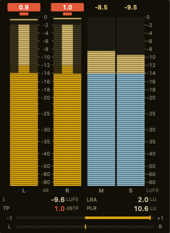
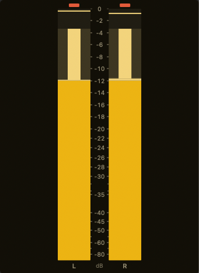
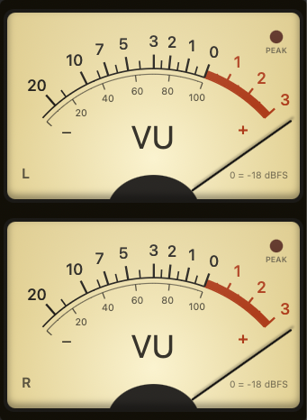
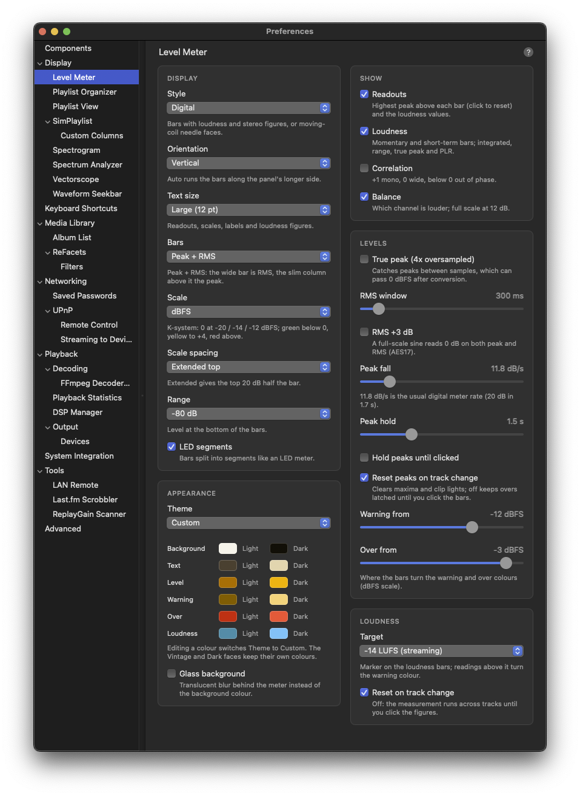

+++
title = "Level Meter for foobar2000 on macOS"
date = 2026-11-17T11:30:00+01:00
description = "A new foobar2000 macOS component: peak, RMS and LUFS loudness in one panel, with an optional analog VU look."
[taxonomies]
tags = ["foobar2000", "macos", "audio"]
+++

Today Jenda merged the **Level Meter** into the [fb2k-components-mac-suite](https://github.com/JendaT/fb2k-components-mac-suite). It's the fourth visualiser I've contributed, and it took about three and a half weeks from the first commit to the 0.1.0 release.

My first three, the Spectrum Analyzer, Vectorscope and Spectrogram, show *what* is in the music. None of them tells you how loud it actually is. Level Meter does: peaks, RMS, LUFS loudness and stereo, in one panel. If you prefer needles to bars, it can be a pair of analog VU meters too.

<div class="shots">
  
  
  
</div>

## What it shows

**Level bars**, one per channel. The wide bar is the RMS level, the slim column inside it is the peak. You see both at a glance, instead of choosing one. Above each bar there's the highest peak so far, and a clip light that stays lit once a peak goes over 0 dBFS.

**True peak.** Peaks are also measured *between* the samples (4x oversampled, as BS.1770 describes). Loud masters often go +0.5 to +2 dB over between samples, even when no single sample does. Those overs light the clip light too, so you'll probably see it more often than you expect.

**Loudness**, after EBU R128:

- **M** and **S** bars: momentary (400 ms) and short-term (3 s) loudness
- **I**: integrated loudness of the whole track
- **LRA**: loudness range, how much the track moves between quiet and loud
- **TP**: highest true peak
- **PLR**: true peak minus integrated loudness. A low number means a heavily limited master.

A line on the M and S bars marks the target (-14 LUFS by default, the usual streaming level).

**Correlation and balance**: two thin bars at the bottom. Correlation goes red when the channels are out of phase, i.e. when parts of the sound would cancel out on a mono speaker.

**Analog VU.** Switch the style and you get backlit needle faces instead of bars. The needle is properly damped: it reaches 99% of a step in 300 ms and overshoots by about 1.3%, as a real VU meter does. There are also three PPM styles (DIN, BBC / EBU, Nordic) if you grew up with those.

## Add it to your layout

Open **View → Layout → Edit Layout…** and add `level_meter`. It works tall and narrow next to other panels, or wide and short under the seekbar. This puts it to the right of the spectrum analyzer:

```
splitter horizontal style=thin
  waveform-seekbar
  splitter vertical style=thin
    spectrum
    level_meter
  simplaylist
  playback-controls
```

New to the layout editor? My [foobar2000 setup post](@/posts/foobar2000-macos-setup/index.md) explains it.

Some handy details:

- **Click** the bars to reset peaks and clip lights; click the loudness figures to start a new measurement. By default, both reset on each new track.
- **Right-click** for Reset Peaks, Reset Loudness, Digital / Analog VU and Preferences.
- On a small panel, the extras give way one by one (balance first, loudness bars last), so the level bars keep their room.

## Settings

Everything is in **Preferences → Display → Level Meter**, and changes apply live:

- **Scales:** dBFS, or K-20 / K-14 / K-12 if you master to the K-System
- **Range:** from -24 down to -120 dB, with extended-top spacing so the loud end gets more detail
- **Ballistics:** RMS window, peak fall rate and hold time
- **Themes:** the same 14 presets as the seekbar and spectrum (P31 green, Nord, Dracula…), drawn in Display P3
- **Text size:** Small to Extra large, for when the meter lives on the other side of the room



## Under the hood

A meter that shows the wrong numbers is worse than no meter, so most of the work went into the measurement, not the drawing.

The measurement core (detectors, loudness, true peak, scales, layout) is plain C++ with no foobar2000 SDK in it. That makes it unit-testable on its own. The tests check the BS.1770 filter coefficients and run the EBU Tech 3341 and 3342 test cases, the official reference signals for loudness meters. The build doesn't produce a component unless they pass.

Drawing is separate: a Core Graphics renderer that takes one snapshot of all readings per frame. Scales and labels are drawn once; only the readings redraw at 60 fps. A small preview tool renders sample panels to PNG without foobar2000, which made checking the design much faster than restarting the player each time.

## Install

You'll need **foobar2000 2.x** and **macOS 12 Monterey or newer**.

1. Download the `.fb2k-component` file from the [Level Meter 0.1.0 release](https://github.com/JendaT/fb2k-components-mac-suite/releases/tag/levelmeter-v0.1.0).
2. Open **Preferences** (⌘,) **→ Components**, click **+** and choose the file.
3. Restart foobar2000 when it asks, then add `level_meter` to your layout.

All the details, from every setting to the ballistics constants, are in the [Level Meter documentation](https://github.com/JendaT/fb2k-components-mac-suite/blob/main/docs/levelmeter.md).

## Feedback

It's version 0.1.0, so expect rough edges.\
Something reads wrong, or your favourite meter from Windows is missing a feature? [Open an issue](https://github.com/JendaT/fb2k-components-mac-suite/issues).
